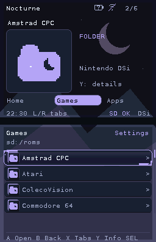
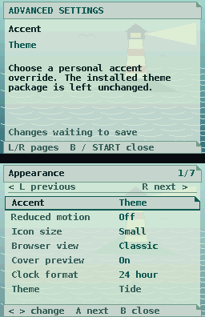

# Gloam Shell NDX

A customizable **BlocksDS shell for the Nintendo DSi SD card**. Browse a game
library, open homebrew and media, and reach system applications from one place,
with both screens doing useful work.

“[Gloam](https://ahdictionary.com/word/search.html?q=gloam)” is an older word for
**twilight**. The name was chosen as a play on the Nintendo DSi's **TWL** codename.

<p align="center">
  
  
</p>

Screenshots show Gloam's renderer with the supplied themes and example content.

## Features

- Two-screen browser with Classic, Extended, List and Grid views, small/large
  icons, looping text and configurable folder tabs.
- Themes with palettes, bitmap fonts, backgrounds, music and UI sounds; personal
  appearance presets and on-console controls.
- Covers and custom icons for games, folders and associated files, with lazy
  artwork loading and a disposable thumbnail cache.
- Folder-aware argv associations, a handler chooser for shared extensions,
  per-item player choices and return-to-loader support for compatible homebrew.
- nds-bootstrap integration with game options, save slots and cheat selection.
- System application shortcuts, installed DSiWare discovery, cartridge icons
  and Slot-1 launching through Simple DS Slot-1 Launcher.
- Favorites and recent items, configuration export/import, recovery mode,
  hidden/save/BIOS folder filters and adjustable scrolling.

**Development status:** physical DSi validation is pending. Launch and return
behavior depends on the title, backend and boot environment. Bundling an official
backend does not resolve the remaining retail compatibility work; see
[current support](docs/CURRENT_SUPPORT.md).

## Install

On Windows, open the graphical SD setup tool:

```powershell
irm https://raw.githubusercontent.com/nextcode4u/gloam-shell-ndx/main/setup.ps1 | iex
```

Choose the SD folder, install/update Gloam and add-ons, and configure ROM folders,
file handlers, tabs and themes. You can also extract `addons.zip` and double-click
`addon-installer/Start Gloam Setup.cmd`. See the [Windows setup guide](docs/guides/WINDOWS_SETUP.md).

Build the SD package below, then merge the contents of `dist/sd.zip` onto a
backed-up SD card. The entry point is `/BOOT.NDS`. Preserve your existing settings,
libraries and other applications' support files when upgrading.

The package includes official nds-bootstrap and Slot-1 Launcher releases,
themes, association profiles and an optional DSi Menu forwarder. Emulators,
required proprietary BIOS files, games and saves are supplied separately.
The optional add-on pack includes compatible free firmware replacements;
[firmware requirements](docs/guides/ADDONS.md#free-replacements-and-remaining-firmware)
list what is included and what each emulator still needs. A DSi homebrew boot method
with SD access is required; Gloam does not install or configure Unlaunch.

For frontend-only updates, replace `/BOOT.NDS` using the standalone `BOOT.NDS`
release download. This leaves settings, themes, backends and libraries untouched.
Read the release notes for any required asset/backend updates.

The SD folder `/_nds/dsi-frontend/` was established before we chose the Gloam
name. It was kept after naming the project to preserve existing settings,
themes, artwork and loader paths. The JSON configs use that same working path;
see [configuration notes](config/README.md).

Simple and Advanced settings support a config-only Simple-mode lock for prepared
consoles; the lock is off by default.

See [setup and controls](docs/GETTING_STARTED.md), [SD layout](docs/guides/SD_LAYOUT.md)
and [emulator associations](docs/guides/EMULATORS.md). For large ROM sets, the
[PowerShell File Organizer Scripts](https://github.com/nextcode4u/PowerShell-File-Organizer-Scripts)
can group each system's loose ROM files into alphabetical subfolders.

## Build

Install [BlocksDS 1.25.0 or later](https://blocksds.skylyrac.net/docs/setup/)
and Python 3.11+. The default SDK location is `/opt/blocksds/core`.

```sh
make -j4                         # frontend and optional forwarder
python3 tools/build_release.py   # pinned backends + SD/source archives
python3 tools/build_addons.py    # check/update pins, validate, build optional overlay
```

Outputs: `dist/BOOT.NDS`, `dist/sd.zip`, `dist/licenses.zip`, `dist/source.zip`
and `dist/SHA256SUMS`. `source.zip` includes matching backend/helper sources
under `dependencies/`. The SD ZIP contains runtime files and collection README.txt notes; licenses and
credits are in `licenses.zip`, and guides stay in the repository and source archive.
Downloads and builds stay in ignored directories. The
packaging script needs Git and internet access on its first run; repeat runs verify cached
inputs. See [building and packaging](docs/development/BUILDING.md) for checks,
source archives, dependency updates and offline use. Optional `dist/addons.zip`
bundles permitted apps with matching license/source companions. Its shared Python
and PowerShell scripts download the remaining pinned apps directly to a chosen SD
root, check installed add-ons and stage reviewed updates with backups. See [usage and the audit](docs/guides/ADDONS.md) for terms and setup.

## Documentation

| Guide | Covers |
| --- | --- |
| [Documentation index](docs/README.md) | All maintained guides |
| [Themes](docs/guides/THEME_PACKAGES.md) / [fonts](docs/guides/THEME_FONTS.md) | Create and customize a theme |
| [Tabs](docs/guides/TABS.md) / [dashboard](docs/guides/DASHBOARD.md) | Organize the shell |
| [Games](docs/guides/GAME_LOADING.md) / [cheats](docs/guides/CHEATS.md) | Backend settings and saves |
| [Installed DSiWare](docs/guides/INSTALLED_DSIWARE.md) / [Slot-1](docs/guides/SLOT1_LAUNCH.md) | Native title and cartridge routes |
| [Build guide](docs/development/BUILDING.md) / [source map](docs/SOURCE_MAP.md) | Fork, build and contribute |

## Credits and license

Gloam is shaped by the work of the DS homebrew community. **AKMenu Next,
TWiLight Menu++, Pico Launcher and HBMenu** informed the browser, compatibility
and configuration design. Their developers established much of what makes a
modern DS frontend practical. Gloam's two-screen organization also draws on
Firmux, an earlier deprecated project by me.

Game loading relies on **nds-bootstrap** by ahezard, RocketRobz and its
contributors, **Simple DS Slot-1 Launcher** by Lorenzooone and its credited
predecessors, and the **nds-bootloader/HBMenu** loader lineage. Gloam also uses
TWiLight Menu++'s ROM save-size table. These contributions retain their names,
copyright notices and licenses. See [credits](CREDITS.md) and the complete
[third-party inventory](THIRD_PARTY.md).

Original Gloam source is **GPL-3.0-or-later**; see [LICENSE](LICENSE).
Dependencies, fonts, music and other assets retain their own licenses.
