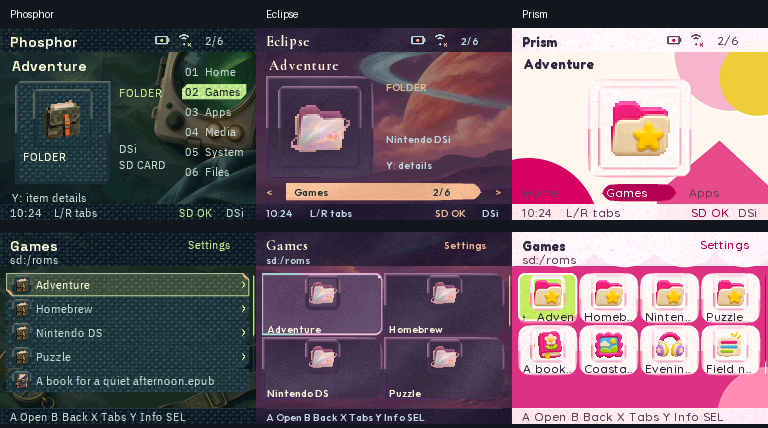

# Gloam Shell NDX

A customizable **Nintendo DSi SD-card launcher built with BlocksDS**. Browse
games, homebrew and media, and open DSi system apps using both screens.

“Gloam” means twilight—a nod to the DSi's **TWL** codename.

**[Download the latest release](https://github.com/nextcode4u/gloam-shell-ndx/releases/latest)**
· [Documentation](https://nextcode4u.github.io/gloam-shell-ndx/)
· [Setup and controls](docs/GETTING_STARTED.md)
· [Themes](https://github.com/nextcode4u/gloam-shell-theme-directory)

<p align="center">
  
</p>

Screenshots use Gloam's renderer with example content.
[See more included themes](docs/images/theme-personalities.png).

## Install

You need a DSi homebrew boot method with SD access. Some system-title routes
require Unlaunch; Gloam does not install it.

**Windows:** run this in PowerShell to open SD Setup:

```powershell
irm https://raw.githubusercontent.com/nextcode4u/gloam-shell-ndx/main/setup.ps1 | iex
```

Choose your SD card or staging folder. The tool installs Gloam and optional
emulators, manages themes and covers, and configures folders and settings.
See the [Windows setup guide](docs/guides/WINDOWS_SETUP.md).

**Manual:** download `sd.zip` from the latest release and merge its contents onto
a backed-up SD card. Launch `/BOOT.NDS` through your homebrew boot method.
Preserve your settings, saves and existing application files.

The SD package includes official nds-bootstrap, Slot-1 Launcher, themes and an
optional DSi Menu forwarder. Games and proprietary BIOS files are not included.
Use SD Setup or the optional `addons.zip` for emulators and players;
[check their BIOS requirements](docs/guides/ADDONS.md#free-replacements-and-remaining-firmware).

**Updating:** replace `/BOOT.NDS` for a launcher-only update. Read the release
notes first: some versions also require updated SD assets. Upgrading from 1.1.0
or earlier to 1.2.0 needs the shared font/language assets; follow the
[upgrade instructions](docs/GETTING_STARTED.md#install-or-upgrade).

## What it does

- Browse with lists, grids, Cover Shelf or Library Index, plus custom folder tabs.
- Customize layouts, fonts, icons, backgrounds, sounds, music and startup splashes.
- Launch games through nds-bootstrap, with per-game options, save slots and cheats.
- Open homebrew and media in associated apps; choose an app when extensions overlap.
- Access installed DSiWare, system apps and Slot-1 cartridges.
- Manage favorites, recent items, covers and optional PC-indexed library search.
- Read Japanese title names and use partial interface translations with English fallback.

Press **START** for settings, **SELECT** for item actions and **L/R** to switch tabs.
See [controls](docs/GETTING_STARTED.md#controls) and
[tested compatibility and known limits](docs/CURRENT_SUPPORT.md).

This README describes current source. Published binaries may have fewer features;
check their release notes. Development builds after 1.2.0 also offer
[additional top-screen views and title metadata](docs/guides/TOP_SCREEN.md).

## Folders

| Content | Default location |
| --- | --- |
| Games | `/roms/` |
| Homebrew games | `/roms/Homebrew Games/` |
| Applications and utilities | `/apps/` |
| Books, music and videos | `/media/` |
| Gloam settings and assets | `/_nds/dsi-frontend/` |

The `dsi-frontend` folder predates the Gloam name. We keep it for compatibility
with existing settings, assets and loader paths. See the [SD layout](docs/guides/SD_LAYOUT.md).

## Build and contribute

Install [BlocksDS 1.25.0 or later](https://blocksds.skylyrac.net/docs/setup/)
and Python 3.11+, then run:

```sh
make -j4                        # Build the launcher and forwarder
python3 tools/build_release.py  # Package BOOT.NDS, sd.zip, source and licenses
python3 tools/build_addons.py   # Build the optional add-on pack
```

Packages go in `dist/`. Packaging needs Git and internet access on its first run.
See [building and checks](docs/development/BUILDING.md),
[the source map](docs/SOURCE_MAP.md) and [contribution rules](CONTRIBUTING.md).

## Guides

| I want to… | Read |
| --- | --- |
| Set up emulators and file associations | [Emulator guide](docs/guides/EMULATORS.md) |
| Configure games, saves or cheats | [Game loading](docs/guides/GAME_LOADING.md) · [Cheats](docs/guides/CHEATS.md) |
| Create or customize a theme | [Theme packages](docs/guides/THEME_PACKAGES.md) · [Fonts](docs/guides/THEME_FONTS.md) |
| Change tabs or the Home screen | [Tabs](docs/guides/TABS.md) · [Dashboard](docs/guides/DASHBOARD.md) |
| Set up another language | [Languages and fonts](docs/guides/TEXT_AND_TITLES.md) |
| Find another topic | [All documentation](docs/README.md) |

## Credits and license

Thanks to **AKMenu Next, TWiLight Menu++, Pico Launcher and HBMenu** for their
work on DS launchers. Gloam's two-screen organization also draws on Firmux,
an earlier deprecated project by me.

Game loading uses **nds-bootstrap**, **Simple DS Slot-1 Launcher** and the
**nds-bootloader/HBMenu** loader lineage, including RocketRobz's reset fixes
retained in Deletecat's fork. Full authorship, reused code and asset notices
are recorded in [Credits](CREDITS.md), [Third-party dependencies](THIRD_PARTY.md)
and [loader provenance](third_party/nds-bootloader/UPSTREAM.md).

Original Gloam source is **GPL-3.0-or-later**; see [LICENSE](LICENSE).
Dependencies and assets keep their own licenses.

## Developer note

Developed with assistance from AI language models. Some code was generated or
refined using AI, then reviewed, modified and integrated by the author where appropriate.
