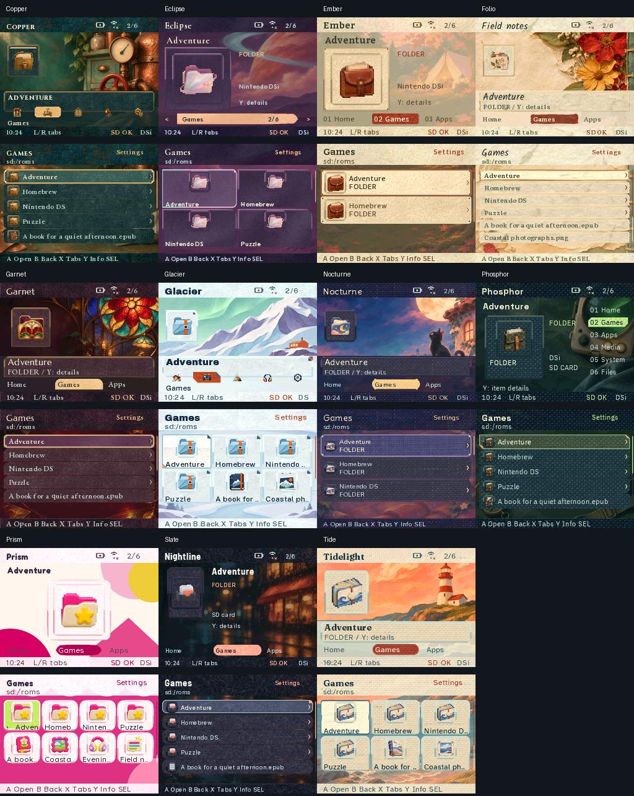

---
hide:
  - navigation
---

# Find your look

[Browse community themes](https://github.com/nextcode4u/gloam-shell-theme-directory){ .md-button .md-button--primary }

## Install a theme

In the Windows setup tool, open **Themes**, then **Refresh theme directory**.
Choose a theme, preview it and select **Download and install selected theme**.

## Use it on your DSi

1. Press **START → Appearance → Theme**.
2. Select a theme and press **X** to preview it.
3. Press **A** when the preview is ready, or **B** to go back.

Want matching music? Set **Background music** to **Theme** in Gloam's audio settings.

[Make your own theme](https://github.com/nextcode4u/gloam-shell-theme-directory#readme)
