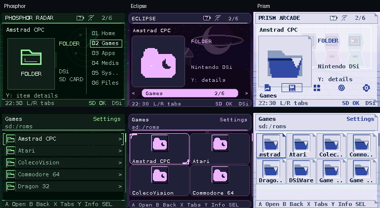
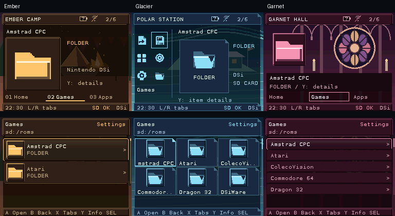

# Theme packages (version 1)

Open **Frontend Settings → Appearance → Theme**. Up/Down previews packages on
both screens. A applies; B/START cancels. Touch selects a preview, then applies
when the same row is selected again. Preview never writes preferences. Applying
records the package ID in normal frontend state; the original package is not
edited. Restart reloads that package. Missing/invalid packages use the built-in
appearance and report the fallback, while retaining the requested ID for repair.

The current package format supports palettes, fixed-cell fonts, per-screen backgrounds, icon packs and audio.
Named on-console appearance snapshots are documented in [APPEARANCE_PRESETS.md](APPEARANCE_PRESETS.md). Bounded layout defaults/spacing/grid overrides are implemented (see below);
variable font metrics and full UI localization remain further work. This version does not interpret AKMenu or
TWiLight theme files directly. Required navigation keeps its shared geometry.

Packages live at `_nds/dsi-frontend/themes/<id>/theme.ini`. IDs use ASCII letters,
numbers, hyphens and underscores and are at most 63 bytes. The chooser includes
Built-in and the alphabetically first 23 valid package directory names. It reads
one selected package at a time; startup does not scan all installed themes.

```ini
[theme]
version=1
name=Slate

[colors]
background=#101820
surface=#20303c
line=#405060
text=#ecf1f5
muted=#abc0cf
accent=#8dbce8
ink=#14202b

[fonts]
ui=builtin
```

`name` and color/font overrides are optional; omitted values use the built-in
base. `version=1` is required. Files are at most 4 KiB with lines shorter than
1 KiB. Unsupported fields/sections and invalid values reject the candidate.
Colors use exactly six hexadecimal RGB digits. Integer brightness-separation
checks reject unreadable text/background, text/surface, muted/background,
accent/background and ink/accent combinations. These checks do not certify a
font's legibility or substitute for native preview and physical LCD review.

The Accent control creates a personal preset-color override without changing the
package. Its 16 choices are Amber, Mint, Iris, Rose, Coral, Sky, Cyan, Lime,
Gold, Peach, Violet, Pink, Teal, Blue, Slate and Silver. Left/Right cycles in
both directions. Bright shades suit dark backgrounds; deeper versions with light
selection text suit light backgrounds. The original first three saved IDs stay
unchanged. Expanded selections persist in state and named appearance snapshots. The value shows Theme until an override is selected. Reapplying a theme
restores its accent. Other browser preferences remain independent of the package.
Copper and Slate demonstrate a packed face and the built-in face respectively;
Folio, Nocturne and Tide add light/dark layouts, wallpapers and original audio. All screens consume the resolved palette, including settings,
file pickers and theme preview. PNG covers retain their existing neutral alpha
matte; they are content artwork rather than theme backgrounds.

## Bundled sample themes

Choose these from START → Appearance → Theme. Preview with Up/Down, apply with
A, or cancel with B. The packages are ready to copy; no build step is needed.

| Theme | Direction | Defaults and features exercised |
| --- | --- | --- |
| Folio | Warm paper and graphite; a quiet reading interface. | List, small icons, no padding, built-in font, no wallpapers/music, three soft UI cues. |
| Nocturne | Indigo mountain silhouettes and lavender highlights. | Extended, small icons, 2px padding, external Latin-1 font, independent PNG wallpapers, original 8-second loop and three UI cues. |
| Tide | Sea-glass paper and broad coastal bands. | Large Grid, three columns, 6px padding, external ASCII font, PNG top/JPEG bottom, original 8-second loop and three brighter UI cues. |
| Phosphor | Near-black and soft terminal green. | Classic, small icons, zero padding, built-in font, no wallpapers/music, three quiet low-pitched cues. A lightweight baseline. |
| Eclipse | Dark plum with a pale lunar halo. | Large Grid, two columns, maximum 12px padding, Latin-1 font, 512×512 PNG/JPEG wallpapers at maximum 35% strength, original 8-second loop. Exercises center cropping and spacious layout limits. |
| Prism | Cool white with blue and lilac facets. | Large Grid, four columns, zero padding, bold ASCII font, native-size PNG/JPEG wallpapers at 35%, original 8-second loop. Exercises narrow labels, looping text and light-theme contrast. |
| Ember | Amber sunset and layered desert silhouettes. | Extended, large icons, 4px padding, Latin-1 font, PNG backgrounds at 25%, warm low-pitched cues and an original 8-second loop. |
| Glacier | Ice-blue peaks against deep navy. | Large Grid, three columns, 4px padding, Latin-1 font, PNG backgrounds at 30%, clear UI tones and an original 8-second loop. |
| Garnet | Black cherry with ruby chevrons. | List, small icons, 2px padding, Latin-1 font, PNG backgrounds at 25%, low UI tones and an original 8-second loop. Keeps the browser focused on names. |

Nocturne and Tide share a 256×384 composition split into native-size
screens. Text and controls are drawn by the launcher; they are not baked into
the artwork. Folio, Nocturne and Tide add about 550 KiB in total. A music loop uses
250 KiB of sample memory only while its theme's music is enabled; unused theme
packages are not preloaded. Folio needs no wallpaper or music buffers.

Eclipse deliberately uses the maximum accepted image dimensions, not oversized
or malformed files. Its outer image area is cropped; both screens retain a
256×192 prepared background. Prism deliberately favors density: long titles
need the selected-label marquee, and Reduced motion keeps those labels static.
Use Eclipse's wider tiles or List view when complete names matter more than
density. Theme packages cannot override Reduced motion or personal audio levels.
These variants exercise supported boundaries, not a measured hardware memory or
frame-time limit. All three have per-package credits and reproducible assets.



Regenerate this gallery with `.venv/bin/python tools/make_screenshots.py --theme-variants`
after building the host renderer. The images show actual renderer output with
the supplied example folders; physical LCD contrast still needs hardware review.



Use `.venv/bin/python tools/make_screenshots.py --theme-variants atmosphere` to
regenerate the second gallery. These three variants use native 256×192 backgrounds
and the same bounded audio format as the other samples; each music loop adds
250 KiB of sample memory only while enabled. Each package includes its own credits
and font license.

START → Audio → Background music must be Theme to hear a package's loop;
Theme sounds enables its cues. Applying a theme respects personal audio levels,
reduced motion and wallpaper overrides. Reset wallpapers to see package art if
personal wallpapers are assigned. Reapplying resets the accent override and
applies the package's browser defaults. Personal view/icon changes still work.
These examples use the existing selection easing, marquee and animated-banner
behavior; packages cannot supply custom animation scripts or widget positions.

Original geometry and synthesized audio are CC0; packed fonts retain the
included DejaVu licenses. Per-package CREDITS.md files record ownership. Rebuild
or verify only these sample assets with the pinned authoring environment:

```sh
.venv/bin/python tools/make_theme_samples.py
.venv/bin/python tools/make_theme_samples.py --check
```

The generator leaves Copper's licensed music and all personal settings alone.
`tools/host-check.sh` loads the actual packages through the native-compatible
loader and checks preview/cancel/apply/restart, both background decoders, WAV
loading and browser/settings bounds. Native LCD readability remains a hardware
check. These are reference packages, not a claim that unsupported theme schemas
or arbitrary UI layouts are implemented.

## Bitmap fonts

`[fonts] ui=fonts/ui.dsfont` loads a relative file contained within the package.
Absolute paths, devices and parent traversal are rejected. A bad/missing face
rejects the candidate; the current active face remains available. The built-in
font is permanently compiled into the ROM.

The pack format is deliberately a restricted first version:

| Bytes | Meaning |
| --- | --- |
| 0–7 | ASCII `DSFONT01` |
| 8–11 | Cell width 7, height 12, first codepoint 32, glyph count 95 |
| 12–15 | Zero reserved bytes |
| 16 onward | 95 glyphs × 12 little-endian uint16 rows |

Each row contains seven two-bit coverage values, low bits first. The top two
bits must be zero. Every printable glyph except space must have visible ink.
The complete file is exactly 2,296 bytes; truncation and trailing data are errors.
Measurement and drawing use the same fixed seven-pixel advance and twelve-pixel
line height. Font replacement therefore cannot change row, column, touch or
footer geometry. UTF-8 drawing and Latin-1 fallback/format-v2 packs are supported; see TEXT_AND_TITLES.md. Other scripts still use `?`. This is not full
UI localization or PCF compatibility.

Theme authors can run:

```sh
python3 tools/pack_theme_font.py source-font.ttf fonts/ui.dsfont --size 11 --baseline 9
```

Pillow/FreeType is an authoring dependency only. The tool checks ink bounds and
advance before rasterization and rejects overflow rather than cropping or
stretching. Ordinary users copy an already prepared package; no compiler is
needed on the console. Font redistribution licenses must accompany the package;
Copper includes the DejaVu license. Larger and variable-width font work is
specified separately in [THEME_FONTS.md](THEME_FONTS.md).

## Recovery

Hold SELECT while the frontend starts to bypass the external theme before its
files are read. Recovery uses built-in fonts/colors, Small/Classic rows, reduced
motion, covers off and Home. Its header says RECOVERY.

Appearance edits in this session are temporary: navigation/favorite saves retain
the normal accent, motion, icon size/view, cover visibility, clock format, theme
ID and accent-override preference. Restart normally to use the saved appearance.
Theme preview remains available by explicit selection, but applying packages is
blocked in recovery. Configuration export/import and reset scopes are described in
[CONFIGURATION_BACKUPS.md](CONFIGURATION_BACKUPS.md); this is not a general SD recovery utility.


## Copper background music

Copper uses “Sentinel” by pixelpion from Pixabay. Its `sounds/loop.wav` contains
the full approximately 43-second track, converted to 12 kHz mono PCM16. The
1,035,648-byte sample buffer fits the existing 1 MiB music cap. Source/license
links, conversion settings and hashes are recorded in Copper's `CREDITS.md`.
The UI cue generator changes only cursor/confirm/back sounds; it leaves this
licensed track intact. Audio validation fixtures use a separate original tone
sequence so their format checks do not depend on the theme's chosen music.

## Backgrounds and on-console wallpapers

Optional package fields:

```ini
[backgrounds]
top=backgrounds/top.png
bottom=backgrounds/bottom.jpg
strength=25
```

Paths stay within the theme package. PNG/JPEG inputs are bounded to 512×512 and
1 MiB compressed data each; images are center-cropped to 256×192 and blended
with the package background color. Strength is 0–35 percent (default 25) so
required text remains legible. Unsupported/missing optional images fall back
individually to the palette. No image decoding or filesystem access occurs in
rendering. Active and preview pixel buffers are allocated only for supplied
images, transferred on Apply and freed on Cancel/replacement.

Appearance → Top wallpaper/Bottom wallpaper chooses personal images anywhere on
SD without editing the theme. Wallpaper strength uses Theme/Off/5–35 percent;
Reset wallpapers restores the package defaults without deleting any image.
Personal wallpaper references persist across theme changes. Recovery bypasses
all external wallpaper reads and blocks changes to normal wallpaper settings.
Refresh metadata also reloads prepared backgrounds.

The drawing/font path now supports fixed-cell Latin-1 packs and UTF-8-aware
measurement. See [TEXT_AND_TITLES.md](TEXT_AND_TITLES.md); wider scripts and
variable glyph metrics still require more work.

## Bounded layout settings

```ini
[layout]
view=grid
icon_size=large
row_padding=6
large_grid_columns=3
```

All keys are optional. `view` accepts classic/extended/list/grid and `icon_size`
accepts small/large. These supply defaults when Apply is pressed; ordinary
Appearance choices can override them afterward and remain saved across restart.
Preview/cancel does not change browser preferences. Named presets retain their
explicit icon/view choices independently of these apply-time defaults.

`row_padding` adds 0–12 pixels to the shared row/cell height; both drawing and
touch/navigation use the resolved size. Large Grid accepts 2–4 columns and
allocates its label width from the actual cell width. Small Grid keeps two
columns to protect label readability. Invalid layout values reject the package
without changing the active theme. Settings, tab rail, required navigation and
font-cell bounds retain their native geometry. Arbitrary widget positions and
unbounded custom layout scripts are not supported.

## Theme icon packs

Optional package-local icons replace the generic symbols used in browser rows,
Home shortcuts, pickers and cover placeholders. Add this to `theme.ini`:

```ini
[icons]
directory=icons
```

Place any of these **32×32 PNGs**, at most **64 KiB each**, in that directory:

- File families: `file.png`, `folder.png`, `game.png`, `application.png`,
  `audio.png`, `video.png`, `book.png`, `text.png`, `image.png`, `save.png`,
  `config.png`, `archive.png`, `shortcut.png`, `system.png`, `missing.png`.
- System fallbacks: `settings.png`, `camera.png`, `sound.png`, `pictochat.png`,
  `download-play.png`, `system-menu.png`, `slot1.png`.

Each image is optional. Missing, malformed or oversized images use the built-in
symbol; they do not invalidate other images or the theme. The directory must
stay inside the theme package (no absolute paths or `..`). PNG colours are kept
as RGB555 with binary transparency (alpha below 128 is transparent), and scaled
without smoothing. Accent overrides do not recolour PNGs. List view stays text-only.

Assigned item icons, native title/cartridge banners and association icons take
priority over theme fallbacks. System images replace fallback symbols only;
readable native system-app banners keep their animations. Cover images remain
independent. Theme icons are static.

Decoding happens on theme load/preview, never in the renderer. Each decoded
image uses 2 KiB; all 22 use 44 KiB, or 88 KiB while previewing a second full
pack. Cancel frees the preview and retains the applied icons. Applying a theme
replaces its icon bank; no per-frame filesystem reads are added.

All eleven bundled themes include matching icon sets. Reproduce or check them:

```sh
.venv/bin/python tools/make_theme_icons.py
.venv/bin/python tools/make_theme_icons.py --check
```

These original icon variants share Gloam's recognizable symbol family, with
palette-specific colours and outline, round or angular badge treatments.
The icons are CC0; each package includes a credit notice.

**Compatibility:** these manifests require a build with `[icons]` support. Older
builds reject unknown theme sections. Update `BOOT.NDS` with these theme packages;
existing third-party themes without `[icons]` continue to use built-in symbols.
