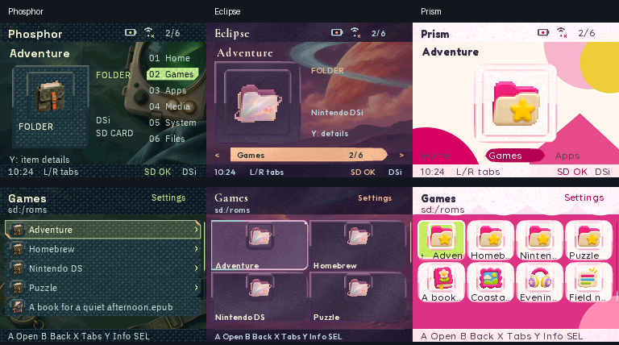
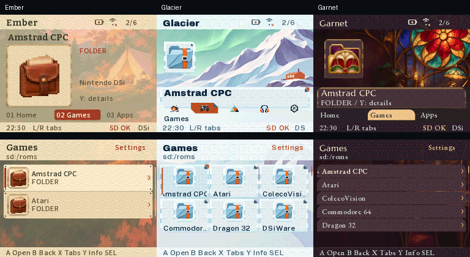
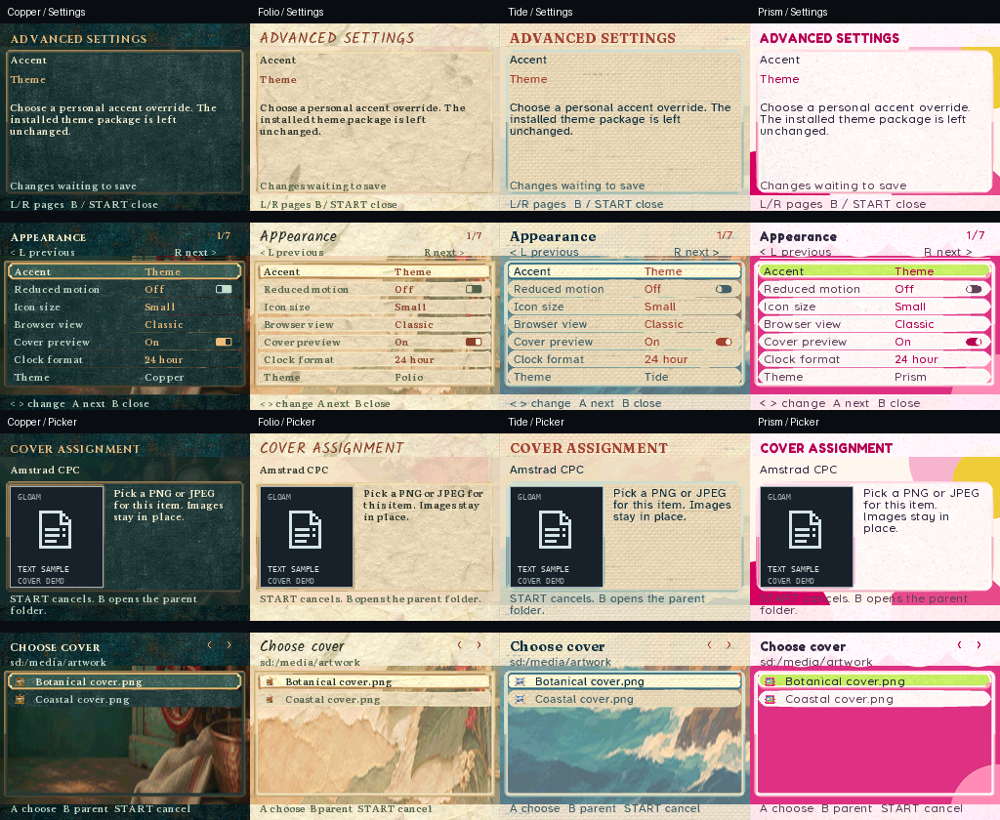
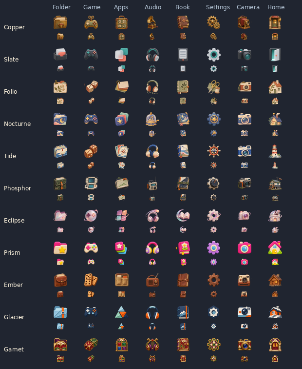
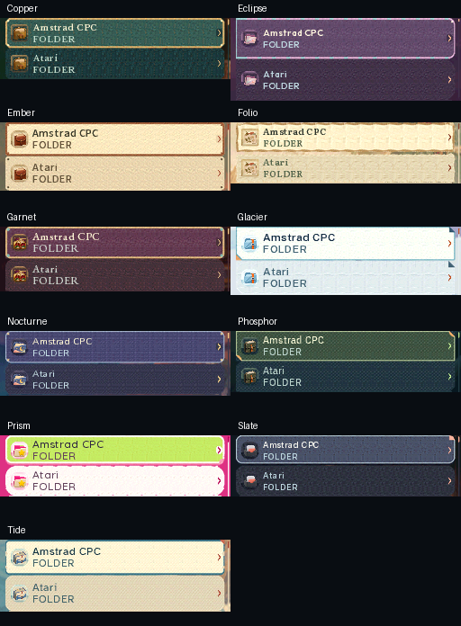

# Theme packages

Version 2 adds independent top/bottom reading-surface opacity, optional
translucent components, proportional body/heading fonts and three additional
composition presets. It requires a
frontend built with version-2 support; Gloam 1.0.0 rejects these packages.
Existing `version=1` themes retain their behavior. New packs declare
`[theme] version=2`; no conversion of older packs is necessary.

Open **Frontend Settings → Appearance → Theme**. Up/Down moves through
the list without loading assets. X loads the selected preview on both screens;
A applies after it is ready. B/START cancels. Touch selects a row, a second tap
requests its preview, and tapping a ready preview applies it. Preview never writes preferences. Applying
records the package ID in normal frontend state; the original package is not
edited. Restart reloads that package. Missing/invalid packages use the built-in
appearance and report the fallback, while retaining the requested ID for repair.

The current package format supports palettes, bitmap fonts, per-screen backgrounds, icon packs, modular UI components and audio.
Named on-console appearance snapshots are documented in [APPEARANCE_PRESETS.md](APPEARANCE_PRESETS.md). Bounded layout defaults/spacing/grid overrides are implemented (see below);
full UI localization is not provided. This version does not interpret AKMenu or
TWiLight theme files directly. Required navigation keeps its shared geometry.

Packages live at `_nds/dsi-frontend/themes/<id>/theme.ini`. IDs use ASCII letters,
numbers, hyphens and underscores and are at most 63 bytes. The chooser includes
Built-in and the alphabetically first 64 valid package directory names.
This capacity is available in source builds after 1.1.0; 1.1.0 lists 23 installed packages. It reads
one selected package at a time; startup does not scan all installed themes.

```ini
[theme]
version=1
name=Slate

[colors]
background=#101820
surface=#20303c
line=#405060
text=#ecf1f5
muted=#abc0cf
accent=#8dbce8
ink=#14202b

[fonts]
ui=builtin
```

`name` and color/font overrides are optional; omitted values use the built-in
base. `version=1` or `version=2` is required. Files are at most 4 KiB with lines shorter than
1 KiB. Unsupported fields/sections and invalid values reject the candidate.
Colors use exactly six hexadecimal RGB digits. Integer brightness-separation
checks reject unreadable text/background, text/surface, muted/background,
accent/background and ink/accent combinations. These checks do not certify a
font's legibility or substitute for native preview and physical LCD review.

The Accent control creates a personal preset-color override without changing the
package. Its 16 choices are Amber, Mint, Iris, Rose, Coral, Sky, Cyan, Lime,
Gold, Peach, Violet, Pink, Teal, Blue, Slate and Silver. Left/Right cycles in
both directions. Bright shades suit dark backgrounds; deeper versions with light
selection text suit light backgrounds. The original first three saved IDs stay
unchanged. Expanded selections persist in state and named appearance snapshots. The value shows Theme until an override is selected. Reapplying a theme
restores its accent. Other browser preferences remain independent of the package.
Copper and Slate demonstrate serif and sans proportional faces respectively;
Folio, Nocturne and Tide add light/dark layouts, wallpapers and original audio. All screens consume the resolved palette, including settings,
file pickers and theme preview. PNG covers retain their existing neutral alpha
matte; they are content artwork rather than theme backgrounds.

## Bundled sample themes

Choose these from START → Appearance → Theme. Preview with Up/Down, apply with
A, or cancel with B. The packages are ready to copy; no build step is needed.

| Theme | Illustrated identity | Browser character |
| --- | --- | --- |
| Copper | Patinated copper, celadon paint, an ivory gauge and red enamel. | Warm serif headings and broad brushed-metal surfaces. |
| Slate | Cinematic night rain, amber windows and coral reflections. | Rounded charcoal surfaces and clean proportional sans text. |
| Folio | Tactile pressed flowers and torn botanical paper collage. | Irregular paper edges, serif type and terracotta marks. |
| Nocturne | A painted cat, terracotta rooftops and a luminous dusk sky. | Soft violet shapes and warm gold accents. |
| Tide | Gouache sea cliffs, peach sky and an ivory lighthouse. | Pale coastal surfaces and smooth navy typography. |
| Phosphor | An expedition map, radar glass, ivory casing and indicator lamps. | Bold chamfered controls and compact sans text. |
| Eclipse | A painted terracotta planet above a surreal violet landscape. | Rounded plum cards and apricot accents. |
| Prism | Bold pink, cream and yellow cut-color shapes. | Bubble forms, lime selection and a centered artwork stage. |
| Ember | An illustrated autumn campsite beneath a rose sky. | Canvas-colored labels, warm serif type and rust highlights. |
| Glacier | Layered paper mountains, mint sky and an orange expedition hut. | Airy ice-colored surfaces and bold navy headings. |
| Garnet | Art-nouveau jewel glass and aged brass in a quiet interior. | Soft aubergine shapes, serif headings and gold accents. |

All eleven bundled packs require version-2 theme support. They include original
native-resolution illustrations, independent screen shading and complementary
file/tab colors. Prepared `assets.gfx` banks avoid individual sprite PNG reads;
the editable PNG sources remain alongside them. Opaque row/card centers protect
text; four-level coverage smooths their edges. Body faces use proportional
DSFONT03 text, with separate 16-pixel heading faces. Supersampling, physical grain
and palette reduction happen on the authoring PC. Native drawing uses finished
32-pixel sprites and 256×192 backgrounds, with no live texture synthesis or blur.
Separate reading surfaces protect the header/footer controls and dialog text
while leaving the browser illustration visible. They are precomposited during
loading and require no additional retained framebuffer. These packs add no
animation scripts or per-frame file reads.

Screen compositions are chosen to suit their character:

- **Scene — Copper, Folio, Nocturne, Tide, Glacier and Garnet:** illustration above a compact
  inspector and horizontal tabs. Tide uses a larger thumbnail; Garnet a portrait
  framed thumbnail beside its rose window.
- **Poster — Eclipse and Ember:** large artwork beside title details,
  with horizontal tabs below.
- **Journal — Slate:** compact portrait artwork beside a heading and
  item facts, leaving the scenery visible around them.
- **Spotlight — Prism:** centered artwork with broad color shapes and navigation below.
- **Right sidebar — Phosphor:** artwork and information on the left,
  with a persistent tab list on the right.

Icons, cover art, labels and status remain live; none are baked into the
background. Ordinary dialogs keep a shaded reading surface. Personal view,
audio and Reduced motion preferences still apply.

The agent-assisted illustration masters and their CC0-1.0 attribution are in
[`assets/theme-art`](../../assets/theme-art/CREDITS.md). Native backgrounds and
reading surfaces are reproducible from those masters with
`.venv/bin/python tools/make_theme_scenes.py`; Prism's vector composition is
authored directly in that tool. No other launcher's theme artwork is
redistributed. Existing music/font notices remain in each package.

[View all eleven rendered themes](../images/theme-personalities.png).
Regenerate with `.venv/bin/python tools/make_screenshots.py --theme-variants personality`.



Regenerate this gallery with `.venv/bin/python tools/make_screenshots.py --theme-variants`
after building the host renderer. The images show actual renderer output with
the supplied example folders; physical LCD contrast still needs hardware review.



Use `.venv/bin/python tools/make_screenshots.py --theme-variants atmosphere` to
regenerate the second gallery. These three variants use native 256×192 backgrounds
and the same bounded audio format as the other samples; each music loop adds
250 KiB of sample memory only while enabled. Each package includes its own credits
and font license.

START → Audio → Background music must be Theme to hear a package's loop;
Theme sounds enables its cues. Applying a theme respects personal audio levels,
reduced motion and wallpaper overrides. Reset wallpapers to see package art if
personal wallpapers are assigned. Reapplying resets the accent override and
applies the package's browser defaults. Personal view/icon changes still work.
These examples use the existing selection easing, marquee and animated-banner
behavior; packages cannot supply custom animation scripts or widget positions.

Original geometry and synthesized UI cues are CC0; separately credited background music retains its own terms; packed fonts retain the
included DejaVu licenses. Per-package CREDITS.md files record ownership. Rebuild
or verify only these sample assets with the pinned authoring environment:

```sh
.venv/bin/python tools/make_theme_samples.py
.venv/bin/python tools/make_theme_samples.py --check
.venv/bin/python tools/make_theme_icons.py
.venv/bin/python tools/make_theme_components.py
# Repeat for each edited package after regenerating its PNGs:
.venv/bin/python tools/pack_theme_assets.py sdroot/_nds/dsi-frontend/themes/copper
```

The generator leaves Copper's licensed music and all personal settings alone.
`tools/host-check.sh` loads the actual packages through the native-compatible
loader and checks preview/cancel/apply/restart, both background decoders, WAV
loading and browser/settings bounds. Native LCD readability remains a hardware
check. These are reference packages, not a claim that unsupported theme schemas
or arbitrary UI layouts are implemented.

## Bitmap fonts

`[fonts] ui=fonts/ui.dsfont` loads a relative file contained within the package.
Absolute paths, devices and parent traversal are rejected. A bad/missing face
rejects the candidate; the current active face remains available. The built-in
font is permanently compiled into the ROM.

The original fixed-cell pack format remains supported:

| Bytes | Meaning |
| --- | --- |
| 0–7 | ASCII `DSFONT01` |
| 8–11 | Cell width 7, height 12, first codepoint 32, glyph count 95 |
| 12–15 | Zero reserved bytes |
| 16 onward | 95 glyphs × 12 little-endian uint16 rows |

Each row contains seven two-bit coverage values, low bits first. The top two
bits must be zero. Every printable glyph except space must have visible ink.
The complete file is exactly 2,296 bytes; truncation and trailing data are errors.
These legacy faces use a seven-pixel advance and twelve-pixel line height.
DSFONT03 instead measures proportional advances, while the body retains the same
line height and browser touch geometry. See [theme fonts](THEME_FONTS.md) for
heading roles and the binary format, and [text and titles](TEXT_AND_TITLES.md)
for UTF-8, built-in script fallbacks and localization limits.

Theme authors can run:

```sh
python3 tools/pack_theme_font.py source-font.ttf fonts/ui.dsfont --size 11 --baseline 9
```

Pillow/FreeType is an authoring dependency only. The tool checks ink bounds and
advance before rasterization and rejects overflow rather than cropping or
stretching. Ordinary users copy an already prepared package; no compiler is
needed on the console. Font redistribution licenses must accompany the package;
Copper includes the DejaVu license. Version-2 themes can load DSFONT03 proportional
body fonts and a separate `[fonts] heading` face with a 12–16-pixel line height.
The role limits, exporter commands and complete format are in [THEME_FONTS.md](THEME_FONTS.md).

## Recovery

Hold SELECT while the frontend starts to bypass the external theme before its
files are read. Recovery uses built-in fonts/colors, Small/Classic rows, reduced
motion, covers off and Home. Its header says RECOVERY.

Appearance edits in this session are temporary: navigation/favorite saves retain
the normal accent, motion, icon size/view, cover visibility, clock format, theme
ID and accent-override preference. Restart normally to use the saved appearance.
Theme preview remains available by explicit selection, but applying packages is
blocked in recovery. Configuration export/import and reset scopes are described in
[CONFIGURATION_BACKUPS.md](CONFIGURATION_BACKUPS.md); this is not a general SD recovery utility.


## Copper background music

Copper uses “Sentinel” by pixelpion from Pixabay. Its `sounds/loop.wav` contains
the full approximately 43-second track, converted to 12 kHz mono PCM16. The
1,035,648-byte sample buffer fits the existing 1 MiB music cap. Source/license
links, conversion settings and hashes are recorded in Copper's `CREDITS.md`.
The UI cue generator changes only cursor/confirm/back sounds; it leaves this
licensed track intact. Audio validation fixtures use a separate original tone
sequence so their format checks do not depend on the theme's chosen music.

## Backgrounds and on-console wallpapers

Optional package fields:

```ini
[backgrounds]
top=backgrounds/top.png
bottom=backgrounds/bottom.jpg
strength=25
```

Paths stay within the theme package. PNG/JPEG inputs are bounded to 512×512 and
1 MiB compressed data each; images are center-cropped to 256×192 and blended
with the package background color. Strength is 0–100 percent (default 25). Full strength preserves the artwork;
authors must place text over calm areas or set `layout/content_opacity` to blend
a reading surface over it. Unsupported/missing optional images fall back
individually to the palette. No image decoding or filesystem access occurs in
rendering. Active and preview pixel buffers are allocated only for supplied
images, transferred on Apply and freed on Cancel/replacement.

Appearance → Top wallpaper/Bottom wallpaper chooses personal images anywhere on
SD without editing the theme. Wallpaper strength uses Theme/Off/5–35 percent;
Reset wallpapers restores the package defaults without deleting any image.
Personal wallpaper references persist across theme changes. Recovery bypasses
all external wallpaper reads and blocks changes to normal wallpaper settings.
Refresh metadata also reloads prepared backgrounds.

Format-2 packages can replace the flat reading mat with separate image assets:

```ini
[backgrounds]
top_surface=backgrounds/paper-top.png
bottom_surface=backgrounds/paper-bottom.png
```

These are exact **256×192 RGBA PNGs**, at most 256 KiB each. Author them at screen
coordinates: transparent pixels reveal the wallpaper, partially transparent pixels
blend over it, and opaque pixels cover it. They are not cropped or stretched.
The screen's content opacity multiplies PNG alpha; use 100 for the authored
coverage (or omit content opacity entirely). Wallpaper strength controls only
the underlying illustration. A personal wallpaper retains the theme's surface.
Missing or invalid surfaces use the existing flat mat instead. The Scene layout
still reveals the original illustration in its exposed strip.

Surfaces are composited at theme load into the existing background buffers;
no additional framebuffer, retained alpha plane or per-frame blending is needed.
They also appear behind settings and file pickers, so keep their text regions
quiet. Moving selection highlights use `components/row-selected.png`; they are
independent of these fixed reading surfaces. This extension requires a build
with reading-surface assets; older builds reject the new keys.

The drawing/font path supports Latin-1 packs and UTF-8-aware pixel measurement.
See [TEXT_AND_TITLES.md](TEXT_AND_TITLES.md) for the shared fallback scripts.

## Bounded layout settings

```ini
[layout]
view=grid
icon_size=large
row_padding=6
large_grid_columns=3
top_layout=poster
chrome=minimal
content_opacity=40
top_content_opacity=20
bottom_content_opacity=75
```

All keys are optional. `view` accepts classic/extended/list/grid/shelf/index and `icon_size`
accepts small/medium/large (16/24/32-pixel browser icons and 32/40/48-pixel Shelf
icons). These supply defaults when Apply is pressed; ordinary
Appearance choices can override them afterward and remain saved across restart.
Preview/cancel does not change browser preferences. Named presets retain their
explicit icon/view choices independently of these apply-time defaults.

Medium icons require a frontend built after 1.1.0. Existing small/large settings
keep their stored values; medium uses `icon_size=2` in state.ini. Theme files use
`icon_size=medium`. List stays text-only. The browser shares icon, row and touch
geometry across the other views.

Version-2 `top_content_opacity` and `bottom_content_opacity` accept 0–100 percent
and override `content_opacity` for their respective screen. Omitted overrides
inherit that shared value, regardless of key order. Lower values reveal more
wallpaper; higher values strengthen the reading surface. Both are preblended
during loading and add no per-frame work or extra pixel buffers. Scene's exposed
illustration strip remains unshaded. Personal wallpaper strength is independent.

Framed browser rows reserve at least four pixels above and below their text or
icon content. Their selection frame stays anchored to the selected row, avoiding
a moving border crossing neighbouring labels. Built-in flat highlights retain
their slide animation.

`row_padding` adds 0–12 pixels to the shared row/cell height; both drawing and
touch/navigation use the resolved size. Large Grid accepts 2–4 columns and
allocates its label width from the actual cell width. Medium Grid uses three columns. Small Grid keeps two
columns to protect label readability. Invalid layout values reject the package
without changing the active theme. Settings, required navigation and font-cell bounds retain their native geometry. Arbitrary widget positions and
unbounded custom layout scripts are not supported. Optional component artwork
changes the appearance of these regions while retaining their input geometry.

In authoring tools, **Interface framing** is the `chrome` INI setting. `full`
draws header/footer component skins and divider lines; `minimal` leaves those
areas open while retaining text and controls. `tab_highlight=skin` uses
`components/tab-selected.png` (or the configured component directory), a 32×32
nine-slice image. Without it, the accent-color fallback remains available.

### Screen composition

These optional composition/color keys require the matching current `BOOT.NDS`.
Older builds reject unknown manifest keys; update the binary along with these
example theme packs. Packages without the new keys keep their previous behavior.

`top_layout` accepts `sidebar` (the original right rail), `sidebar_left`,
`poster`, or `scene`; version 2 also accepts [Spotlight, Gallery, Journal, Panorama, Dossier and
Portrait](#version-2-composition-presets). The left rail moves the artwork and information together without
mirroring text or wallpaper. Poster uses a larger artwork area and a horizontal
strip showing the focused tab and its neighbours. L/R still cycles all tabs;
X enters tab selection, where Up/Down and A retain their usual behavior. Long
labels continue to loop. Item information and Library Index temporarily use the
full six-row right rail instead of squeezing their contents into the poster.

Scene reserves y=24..117 for an illustration, with item information below it and
contextual navigation. Y opens the regular item inspector; Library Index keeps
its index workspace. It uses the package's top background, including personal
wallpaper strength, but preserves an unshaded copy of just that illustration
strip. This costs **47 KiB per active/preview scene** in addition to normal
background buffers. Loading prepares both surfaces; drawing only copies pixels.
Missing images or allocation failure fall back to the normal prepared background.

Authors can place the cover around their subject:

```ini
[layout]
top_layout=scene
scene_cover_x=14
scene_cover_y=34
scene_cover_width=48
scene_cover_height=72
content_opacity=82
```

The cover fits this box without changing aspect ratio. Width is 8–96 pixels,
height 8–90; the complete box must stay within x=2..253 and y=26..115, reserving
two pixels for its frame. Invalid boxes reject the package. Show covers still
controls the live thumbnail; backgrounds remain independent. Coordinates do
not relocate touch targets or the item inspector.

`chrome=full` retains header/footer images and browser separators.
`chrome=minimal` omits those component images and the browser heading/divider
lines, leaving required headings, settings access and button hints visible.
Dialogs retain their own separators. Selected rows/cards remain skinnable.

`content_opacity=0..100` blends the palette background over the inner reading
surface (x=6..249, y=4..187) of both wallpapers; 0 preserves the image, 100 makes
that area opaque. The outer edge keeps its original strength. This is prepared
when loading the theme, adds no image allocation and does no blending per frame.
The default is 0, preserving existing packages. Personal wallpaper strength
remains a separate user override.

Source builds after 1.1.0 also accept optional `[colors] header_text`,
`footer_text` and `header_link_text` RGB colors. They separate title-bar text,
status/footer legends and the browser's Settings link from body text. Each
omitted field retains its existing per-view fallback. `header_text` also covers
title-bar counters and paths inside the taller browser header. These colors do
not recolor icon PNGs; authors should provide suitable status glyphs for their
header artwork. A pack using these fields requires a build that supports them;
the original 1.1.0 parser rejects the new keys.

Optional `[colors] selection_text` sets focused browser-row, quick/action-menu,
settings-label and picker-label text. `[colors] tab_text` sets active navigation
text. Omitted values inherit `text` and `ink`, respectively. Secondary metadata,
settings values and other dialog text retain their established palette roles;
check these against the selected component artwork too. PNG colors are not
recolored by palette or accent changes.

The bundled packs demonstrate Scene, both sidebar directions and Poster. These compositions
work with all browser views and do not change bottom-screen touch targets.

### Tab presentation

Tab presentation is independent of `top_layout` and the bottom browser view.
These keys require the matching current `BOOT.NDS`; older builds reject unknown
keys. Omitted keys preserve label tabs with a skinned selection, three horizontal
cells and a four-pixel gap.

```ini
[layout]
tab_style=icons
tab_highlight=outline
tab_visible=5
tab_gap=8
```

| Key | Values | Effect |
| --- | --- | --- |
| `tab_style` | `labels`, `icons`, `numbered`, `pager` | Changes navigation presentation, not the user's configured tabs. |
| `tab_highlight` | `skin`, `underline`, `outline` | Uses `tab-selected.png` (accent fill fallback), a two-pixel underline, or a one-pixel outline. |
| `tab_visible` | 3–5 | Number of horizontal label/icon/numbered cells. Sidebars show up to six; Pager shows one. |
| `tab_gap` | 0–8 | Horizontal space between cells, in pixels. Does not affect sidebar geometry or Pager. |

- **Labels** show a scrolling window of names.
- **Icons** use a horizontal dock for Scene/Poster, or a two-column tile selector
  in a sidebar. The focused tab's full name has its own scrolling caption.
  Scene omits its secondary file-type/size line to make room for that caption;
  Y still opens complete item information. Poster reserves the dock area by
  reducing its artwork height, including the frame, while preserving aspect ratio.
- **Numbered** prefix names with their one-based position. Three horizontal
  cells give names more space than five; selected long names scroll.
- **Pager** shows one focused category with its position and navigation hints.
  In a sidebar it includes a larger category icon; horizontally it is a single
  wide selector between arrows.

Dock/tile/pager icons have independent assets: `tab-home.png`, `tab-games.png`,
`tab-apps.png`, `tab-media.png`, `tab-system.png`, `tab-files.png` and
`tab-folder.png` (custom folder tabs), all in the existing icons directory.
Omitting one falls back to the theme's existing shortcut, game, application,
audio, system or folder icon. A malformed asset also falls back independently.
Changing tab artwork does not replace browser file-type icons or native banners.
Selection artwork applies only to `skin`; outline/underline keep ordinary text
colors for contrast. Existing `tab_text` controls text on skinned selections.
Authored PNG icons keep their own colors; `tab_text` does not recolor them.
Prefer outline/underline when an icon shares the selection fill color, otherwise
its silhouette can disappear into the highlight. Check the System gear as well
as folders, and the sidebar Pager used by the item inspector.

All styles keep L/R cycling and X → Up/Down → A selection. Windows follow the
focused tab, including custom tabs beyond the visible count. Reduced motion
continues to stop marquees. These controls do not move touch targets: navigation
is on the non-touch top screen. Item information and Library Index retain their
sidebar workspace and use the same tab presentation there.

Copper and Prism demonstrate icon docks; Glacier demonstrates icon tiles.
Nocturne and Eclipse demonstrate Pager. Folio, Phosphor and Ember demonstrate
numbered tabs. Slate, Tide and Garnet retain labels with outline/underline
selection treatments.

## Theme icon packs

Optional package-local icons replace the generic symbols used in browser rows,
Home shortcuts, pickers and cover placeholders. Add this to `theme.ini`:

```ini
[icons]
directory=icons
```

Place any of these **32×32 PNGs**, at most **64 KiB each**, in that directory:

- File families: `file.png`, `folder.png`, `game.png`, `application.png`,
  `audio.png`, `video.png`, `book.png`, `text.png`, `image.png`, `save.png`,
  `config.png`, `archive.png`, `shortcut.png`, `system.png`, `missing.png`.
- System fallbacks: `settings.png`, `camera.png`, `sound.png`, `pictochat.png`,
  `download-play.png`, `system-menu.png`, `slot1.png`.
- Navigation: `tab-home.png`, `tab-games.png`, `tab-apps.png`, `tab-media.png`,
  `tab-system.png`, `tab-files.png`, `tab-folder.png`.

Each image is optional. Missing, malformed or oversized images use the built-in
symbol; they do not invalidate other images or the theme. The directory must
stay inside the theme package (no absolute paths or `..`). PNG colours are kept
as RGB555 with binary transparency (alpha below 128 is transparent), and scaled
without smoothing. Accent overrides do not recolour PNGs. List view stays text-only.

Assigned item icons, native title/cartridge banners and association icons take
priority over theme fallbacks. System images replace fallback symbols only;
readable native system-app banners keep their animations. Cover images remain
independent. Theme icons are static.

Decoding happens on theme load/preview, never in the renderer. Each decoded
image uses 2 KiB; all 29 use 58 KiB, or 116 KiB while previewing a second full
pack. Cancel frees the preview and retains the applied icons. Applying a theme
replaces its icon bank; no per-frame filesystem reads are added.

All eleven bundled themes include matching icon sets. Dedicated navigation art
is authored on a 16-pixel grid and stored at 32×32 with nearest-neighbour scaling,
so it remains readable in the 16-pixel dock. Copper uses a workshop, handheld,
wrench and record; Prism uses an arcade cabinet, joystick, blocks and headphones.
System/Settings gears have distinct teeth and a transparent center.

Reproduce or check them:

```sh
.venv/bin/python tools/make_theme_icons.py
.venv/bin/python tools/make_theme_icons.py --check
```

The original icon artwork uses terminal outlines, rounded lunar shapes, folded
paper and beveled retro forms. Icons are complete designs, not stock masks
laid over decorative badges.
The icons are CC0; each package includes a credit notice.

**Compatibility:** these manifests require a build with `[icons]` support. Older
builds reject unknown theme sections. Update `BOOT.NDS` with these theme packages;
existing third-party themes without `[icons]` continue to use built-in symbols.

## Header and console status

```ini
[theme]
version=1
name=My theme
header=My library
```

`header` replaces the top-screen Gloam label. Omit it for `GLOAM SHELL NDX`, or
use an empty value to hide that text. The limit is 63 UTF-8 bytes; long labels
loop within their reserved width, while Reduced motion keeps them static.
Recovery always displays `RECOVERY`. Battery, wireless and tab position retain
reserved space on the right, independently of the header text.

Battery sprites reflect the raw hardware levels, grouped into empty/low/half/high/
full, with separate charging and unknown states. They are not a percentage or a
runtime estimate. Gloam currently does not establish a Wi-Fi connection:
`wireless-idle.png` means **not connected by Gloam**, not radio power-off or a
hardware switch reading. It never claims signal strength from an LED or saved
credentials. Missing status sprites use built-in readable symbols. Status art is
shown on the main browser header; dialog titles retain their existing space.

## Modular UI artwork

Themes can replace individual UI surfaces without changing touch targets or
copying a whole screen image. The text, icons, scrolling and input behavior
remain live. Each component is independent: mix your own header with the
built-in selection style, or copy only a card treatment from another Gloam pack.

```ini
[components]
directory=components
border=8
```

Inside that package-local directory, supply any of these **32×32 PNGs**:

| Filename | Used for |
| --- | --- |
| `header.png` | Browser and dialog headings on both screens. |
| `footer.png` | Bottom control/status bands on both screens. |
| `panel.png` | Quick controls, item actions, settings explanations, picker inspectors and the Scene item-information strip. |
| `row.png` | Ordinary browser rows; drawn beneath the moving selection. |
| `icon-frame.png` | Transparent bezel around native/associated browser icons. |
| `artwork-frame.png` | Open frame around artwork, picker previews and settings/picker lists. |
| `battery-empty.png`, `battery-low.png`, `battery-half.png`, `battery-high.png`, `battery-full.png` | Battery level sprites. |
| `battery-charging.png`, `battery-unknown.png` | Charging or unavailable battery reading. |
| `wireless-idle.png` | No active connection established by Gloam. |
| `update-available.png` | Optional update notification; replaces the wireless slot while a newer release is known. |
| `row-selected.png` | Selected browser rows, settings, pickers and editors. |
| `tab-selected.png` | The active top-screen tab and the theme preview's selection sample. |
| `card.png` | Unselected Grid/Shelf cells and the top-screen cover placeholder. |
| `card-selected.png` | Selected Grid/Shelf cell. |

Status sprites scale as a whole from 32×32 to 16×16; keep their design bold enough
to read at that size. Other images use **nine-slice scaling**: four corners stay at their authored size;
the four edges stretch in one direction and the center stretches in both.
`border` specifies the source corner width (0–12 pixels, default 8). Zero stretches
the whole image. When a destination is too small for both corners, the corners
shrink to fit. This keeps an outline or folded corner intact on a short row and
a tall cover card. All output clips to the screen, including moving Shelf cards.
Avoid words and icons inside these images: Gloam draws the live content over them.

Version-2 packs can set `fill=tile` in `[components]` to repeat the center and
the length of each edge instead of stretching their texture. Corners keep the
same border treatment. The repeat period is `32 - 2 * border` pixels: with
`border=8`, a 16×16 material fills the center at native pitch. Make opposite
edges of that center meet cleanly. Missing `fill` or `fill=stretch` retains the
existing scaling. Status/control glyphs and scroll tracks keep their usual
scaling, independent of this setting. Clipping does not restart the pattern.

The bundled packs use complete material images from the original
`assets/theme-art/materials.png` studies. `make_theme_scenes.py` bakes full-width
header/footer artwork into the existing reading-surface PNGs. No additional
framebuffer is retained for these bands.

For resizable rows, cards and panels, version-2 packs can supply optional
**256×192 opaque PNG** shade fields:

```ini
[components]
directory=components
border=8
fill=stretch
material=components/material.png
focus_material=components/focus-material.png
```

A field is a full-screen grayscale image, sampled at screen coordinates without
wrapping or tiling. It affects the flat fill color matching the component's center
pixel; borders, ornament, cutouts and coverage remain authored in the 32×32 PNG.
Status glyphs and open artwork/icon frames are excluded. A transparent center
disables material shading for that component. Mid-gray (128–143) leaves the fill
unchanged; darker/lighter levels select prepared RGB555 shades. Full black/white
correspond to offsets −8/+7 per five-bit channel, with saturation at either end.
Keep contrast low behind text. `tools/theme_materials.py` prepares these fields,
including a distinct focus image, and keeps their full-image detail.

Each field is packed into **24 KiB** during theme loading. Ordinary and focus
fields therefore add at most **48 KiB per active or preview bank**, plus a small
prepared color table. The decoder uses bounded transient RGBA storage. No PNG
decoding, file access or allocation occurs during rendering; pixels use cached
shade lookups. Physical-console timing still needs measurement.

Omit `focus_material` to reuse the ordinary field with the selection's fill
color. Missing, malformed, oversized or translucent fields fall back to the
ordinary field or untextured component fill. Identical ordinary/focus paths share
one cached field. Cancel/apply follow the existing isolated theme-bank lifecycle.

Install the matching frontend binary with these updated bundled themes. Older
binaries reject these optional fields; older packages without them retain their
existing drawing behavior. The optional `fill=tile` mode remains available for
intentional repeating motifs, but the bundled material artwork uses full images.

Keep the center stretch region of `artwork-frame.png` and `icon-frame.png`
transparent. The bundled packs leave source pixels 8–23 clear in both directions;
their material lives in the perimeter. Picker previews draw inside this frame,
and settings/picker labels retain their usual clipping and touch bounds. Ordinary
picker/settings choices use `row.png`; the focused choice uses `row-selected.png`.
Older packs without those optional assets retain the standard drawing.

Each PNG is at most 64 KiB. By default binary alpha and RGB555 follow the icon contract.
Version-2 packs can add `alpha=coverage` in `[components]` to retain four levels:
transparent, one-third, two-thirds and opaque. The loader rounds PNG alpha to
the nearest level. `alpha=binary` retains the original threshold. This affects
only component PNGs, including status sprites, never native banners or file icons.
Use partial coverage for glass fills, soft shadow edges and layered borders;
keep modal panels opaque so underlying labels do not compete with dialog text.

Only images containing partial coverage retain a packed 256-byte alpha plane.
Nineteen base components add at most 4,864 bytes per active/preview bank;
enabling all eleven optional controls raises that coverage limit to 7,680 bytes.
Opaque and binary components retain the direct-copy path. Partial pixels blend
against the actual prepared screen; no full-screen scratch buffer or live blur
is allocated. Rendering cost depends on the area of translucent components and
must still be checked on a physical DSi.
Missing or invalid images fall back individually to the built-in drawing for
that region. An unselected Grid cell without a component stays transparent.
Paths cannot leave the theme package. A malformed manifest, including a border
outside 0–12, rejects the preview; Apply/Cancel never mixes asset banks.

Use palette `surface` behind normal text and `accent` behind tab text (`ink`).
PNG colors are fixed and personal accent changes do not recolor them. The loader's
palette checks cannot certify contrast inside arbitrary artwork; inspect both
screens, small/large icons, every view and settings before sharing a pack.

All eleven supplied packs include components. Folio uses torn-paper silhouettes,
Slate and Eclipse use broad rounded surfaces, Prism uses bubble forms, and
Phosphor uses bold chamfered shapes. The sprites are supersampled on the PC;
the DSi loads their finished pixels. Regenerate them with:

```sh
.venv/bin/python tools/make_theme_components.py
.venv/bin/python tools/make_theme_components.py --check
```

Components decode only when loading or previewing a theme. Nineteen complete images
use 38 KiB, or 76 KiB with a second preview bank. No scripts, filesystem reads or
image decoding run in drawing. Recovery bypasses external components. The desktop
setup tool previews and validates them along with icons. Older builds reject the
new section: update `BOOT.NDS` together with these theme packs.

### Optional control artwork

Version-2 packs can add `controls=on` under `[components]`. Without this opt-in,
Gloam does not look for the extra files, preserving older packs' loading work.
Each control is an optional 32×32 PNG with the same alpha and size rules:

| Files | Destination |
| --- | --- |
| `check-off.png`, `check-on.png` | 14×12 cheat selection boxes. |
| `toggle-off.png`, `toggle-on.png` | 18×12 settings switches beside the textual value. |
| `arrow-left.png`, `arrow-right.png`, `arrow-up.png`, `arrow-down.png` | 8×10 browser, picker and quick-panel arrows. |
| `scroll-track.png`, `scroll-thumb.png` | Two-pixel-wide browser scrollbar, stretched to the required height. |
| `busy.png` | 12×12 indicator during an initial empty directory scan. |

Controls scale as whole sprites except the scrollbar, which uses nine-slice
scaling. Keep small designs bold. Missing controls retain the standard drawing;
touch bounds, input handling and text labels stay unchanged. All thirty component
pixel buffers use at most 60 KiB per bank, plus optional coverage planes.

All bundled packs opt into these controls. Material rims are prepared from the
illustration masters during authoring, with opaque reading areas and open preview
centers; the renderer does not sample textures or decode images while drawing.
The UI asset bank remains one prepared file per theme.



Regenerate this gallery with `.venv/bin/python tools/make_screenshots.py --theme-dialogs`
after rebuilding the host preview.

### Lightweight feedback and accents

```ini
[motion]
focus=pulse
ambient=motion/ambient.gtm
ambient_ticks=12
```

`focus=off` is the default. `pulse` adds a brief, twelve-frame margin gleam to a
newly selected row/card without moving its border or delaying input. Reduced
motion disables the gleam.

`ambient` is an optional prepared accent, drawn at 16×16 in a reserved top-header
area at (136, 4). The header label uses the remaining width. It never covers the
title preview, tabs or status icons. Loading waits until at least 90 frames after
startup and 30 selection-idle frames, with a usable SD/browser and no modal,
picker, theme preview or directory scan. A failed load is not retried every frame.
Animation pauses during those activities; Reduced motion shows its first frame.
The active accent is freed when replacing the theme. Recovery bypasses it.

`ambient_ticks` is 5–120 frames per accent frame, default 12 (5 fps at 60 Hz).
The `GLMFX001` format has a 16-byte header: eight magic bytes, one frame-count
byte (1–8), width and height bytes (both 32), then five zero bytes. Each frame
contains 1,024 little-endian RGB555 pixels and 256 packed coverage bytes, four
two-bit values per byte, low bits first. Coverage levels are 0/1/2/3; opaque RGB555
colors have bit 15 set. Exact length is required. Eight frames retain 18 KiB;
there are no per-frame file reads, image decodes or allocations. The theme
directory's `tools/theme_finishing.py` shows an authoring example. This is one
small accent, not a general animation engine or a full-screen background movie.

### Prepared sprite bundles

Keep PNGs as editable sources and optionally prepare icons and components with:

```sh
python tools/pack_theme_assets.py /path/to/theme
```

Add `[assets] prepared=assets.gfx` to a version-2 manifest. The tool uses Pillow
only on the computer. Gloam then reads one compressed bundle instead of opening
and decoding each sprite PNG. Missing records or an invalid/unavailable bundle
fall back to the corresponding PNGs. Fonts and audio remain separate. The current
converter also prepares full-screen backgrounds, reading-surface blends and
material maps, avoiding those PNG decodes during startup and preview.

**Rebuild the bundle after editing a source PNG**, or remove the `prepared` key
while authoring. The prepared copy takes precedence; Gloam does not scan source
timestamps at startup. Copy both the bundle and PNGs when distributing a theme.

`GLMART01` starts with an eight-byte magic, a little-endian uint32 decoded size
and uint32 record count, followed by one zlib stream with its checksum. Each
record contains group (0 icon, 1 component), zero reserved byte, uint16 index,
uint32 payload length, then its pixels. Indices follow the packer's `ICONS` and
`COMPONENTS` lists. Icons contain 2,048 RGB555 bytes; components append a 256-byte
coverage plane. Duplicate indices, unknown groups/indices, invalid lengths and
truncated streams reject the bundle. Legacy decoded data is capped at 192 KiB and
compressed data at decoded size plus 1,024 bytes.

Preparation temporarily retains the compressed and decoded data while copying
sprites into the normal caches, then frees both. A complete current 59-sprite
set decodes to 128,984 bytes; authors should account for that transient memory
alongside active/preview caches. No bundle decoding happens during rendering.

### Cover shelf

Choose **Shelf** in browser appearance settings, or set `view=shelf` in a theme.
The selected cover stays centered between its neighbors on a continuous shelf.
Left/right moves one item, up/down skips three, and L/R switches tabs. The full
selected name scrolls below the shelf; details remain on the top screen. Tap a
neighbor to select it, then tap the selected item to open it. Home and custom
folder tabs use the same layout. Reduced motion disables the horizontal slide.

Jackets retain their size while artwork resolves. Missing covers and native
banners follow the icon-size setting: Small uses 32 pixels and Large uses 48,
including animated banners. Cards stay the same size, and covers retain their
aspect ratio inside the jackets. Row-padding and grid-column settings apply
to their other layouts.

Three path-keyed prepared images are retained across selection changes and
invalidated on explicit refresh. One entry is prepared per tick using the
existing bounded decoder/cache. Shelf adds approximately 62 KiB of prepared
image and path storage; rendering never reads files or decodes artwork.

### Library Index

Choose **Index** under START → Appearance → Browser view, or use `view=index`
in a theme. The bottom screen shows a title list with small (16-pixel) or large (32-pixel)
icons and matching row spacing; the top
screen shows folders and alphabetical groups. Left/Right jumps to the first
item in the next populated group, wrapping past empty groups. Up/Down browses
normally; L/R changes tabs and Y switches to item details.

Groups count the current directory batch, not the entire SD card. Existing
sorting stays intact. Common Latin-1 accented initials join their base letter;
other scripts and punctuation appear under `*` (Other). Genre metadata is not
required. Index honors the icon-size setting and theme row padding.

The update notification has a built-in accent-colored arrow when its optional
32×32 PNG is absent. It uses the same 16×16 status bounds as wireless artwork,
so enabling it does not shorten the header or move tabs. While the checker is
connected, a small accent-colored W indicates an active connection; it does not
claim a signal-strength reading.

## Optional startup splash

Place `splash.gsp` inside the theme folder to supply a startup splash. No INI key
is needed. Users can disable it or select their own override. See
[startup splashes](STARTUP_SPLASHES.md) for the builder, playback behavior and format limits.

## Version 2 composition presets

Version 2 supports six bounded top-screen compositions. Panorama, Dossier and
Portrait require a frontend built after 1.1.0. Each accepts
`tabs_position=top` or `tabs_position=bottom`, with the existing `tab_style`,
`tab_visible`, `tab_gap` and highlight controls. Omit the position to use the
preset's default. These fields do not move the bottom browser or its touch areas.

| `top_layout` | Composition | Default navigation |
| --- | --- | --- |
| `spotlight` | Wide heading above a centered artwork card; illustration surrounds it. | Bottom |
| `gallery` | Heading above artwork at left and item facts at right. | Top |
| `journal` | Small portrait artwork beside a heading and a column of item facts. | Bottom |
| `panorama` | Wide centered artwork with the selected title underneath. | Bottom |
| `dossier` | Heading across the top, facts at left and artwork at right. | Bottom |
| `portrait` | Tall left artwork beside a right-hand title and facts column. | Bottom |

Artwork keeps its aspect ratio. Native banners use the themed card, including
while cover metadata resolves. The renderer reserves heading, frame and navigation
bounds for both 12–16-pixel heading faces and every tab style. Showing item details,
turning covers off or using Library index switches to the existing inspector/index
with its side navigation. L/R and X navigation keep their usual behavior.

`tabs_position` applies only to these six presets; it rejects incompatible
combinations rather than silently ignoring them. Existing `sidebar`,
`sidebar_left`, `poster` and `scene` retain their original compositions.

## Bundled visual sets

The eleven bundled themes use independent illustrated icon atlases, different
body/heading font families, and material-specific cards, tabs and controls.
Navigation and related file types share objects within their own theme. Native
DS/DSi banners and configured emulator icons retain their title artwork.



Icon masters are in `assets/theme-art/*-icons.png`. Reproduce their native
sprites with `python3 tools/make_theme_icons.py`, then run
`python3 tools/pack_theme_assets.py <theme-folder>` to rebuild the prepared bank.
Source atlases never load on the console. The icon count and native pixel cache
size stay unchanged; the richer RGB555 artwork changes compressed package size,
not the per-frame drawing path. See [theme fonts](THEME_FONTS.md) for the separate
OFL face inputs and offline preparation.

### Independent focus artwork

The bundled packs use full selected-row and selected-card artwork instead of a
common leading stripe. Focus changes both the material sample and the fill:
brass/enamel plates in Copper, taped paper in Folio, a stitched linen applique
in Nocturne, a field tag in Phosphor, a folded ticket in Glacier and a satin
jewel setting in Garnet. Slate, Tide, Eclipse, Prism and Ember have their own
slab, nautical ticket, capsule, puffy sticker and leather-label treatments.

`tools/theme_selections.py` authors these silhouettes and trim; the material
preparer uses distinct focus samples. Corners fit inside the eight-pixel source
border, keeping ornament outside live labels and native icons. The same
`row-selected.png` skin applies to browser rows, settings and pickers;
`card-selected.png` supplies Grid/Shelf focus. Focus ornament stays in those
existing sprite slots; the optional full-image fields above supply material
detail. Packs need no custom renderer code.



Regenerate this comparison through the actual host renderer with
`python3 tools/make_screenshots.py --theme-selections`.

## Prepared screen and material records

The current converter writes `GLMART02`, retaining the original 16-byte header
and icon/component records. Group 2, indices 0/1, adds top/bottom screen records:
a uint32 signature, uint32 flags (ready=1, source wallpaper=2, scene strip=4),
98,304 RGB555 bytes and, when flagged, the 48,128-byte top scene strip. Group 3,
indices 0/1, adds ordinary/focused material records: a uint32 signature followed
by 24,576 packed four-bit shade bytes. Reserved bits, duplicate entries and
incorrect lengths reject the entire bundle and retain PNG fallback.

Signatures use FNV-1a over blend parameters and theme-relative source paths/sizes,
with integers encoded little endian. Screens include background color, strength,
resolved content opacity and scene mode. The fast path is skipped when personal
wallpapers, blend settings or source sizes differ. JPEG backgrounds and high-depth PNGs remain on
the native decoder path to preserve its exact rounding.

**Repack after any PNG edit, including same-size edits.** These are prepared
assets rather than a content-addressed disk cache; source timestamps and full
image hashes are not scanned on every preview. The zlib checksum validates the
prepared payload. PNGs remain required editable sources and fallbacks.

Decoded bundles are bounded to 512 KiB, with compressed input bounded to that
decoded size plus 1,024 bytes. Temporary packed/decoded buffers are freed after
copying into the existing active/preview banks; no extra retained framebuffer
is introduced. This trades bounded temporary memory for fewer SD opens and
no runtime PNG conversion/blending when default assets match.

Older Gloam builds reject `GLMART02` and use the included PNGs; new builds also
accept `GLMART01`. No theme.ini or theme-format version change is required.
Update both BOOT.NDS and assets.gfx to benefit from prepared surfaces.

Background tracks in the supplied packs are licensed recordings rather than
placeholder tone loops. `tools/prepare_theme_music.py` verifies the reviewed WAVs;
`--rebuild --download` reproduces excerpts from pinned originals using FFmpeg.
Source downloads stay under ignored build storage. Each pack retains its track
credit/adaptation notes in MUSIC.md and full terms in MUSIC-LICENSE.txt; release
packaging moves both into licenses.zip. Copper retains the earlier user-selected
Sentinel track and its existing Pixabay notice. No runtime audio limit is raised.

## Minimum frontend version

A theme may declare `[theme] min_frontend=v1.2.0` (or a numeric preview/RC tag).
Use the first released frontend supporting its required features. New frontends
reject a newer requirement before decoding assets and show the required version;
the active appearance is retained. Startup uses built-in appearance if the saved
package is too new. Omitted requirements preserve existing package behavior.
This key requires a source build after 1.1.0; older parsers report it as an invalid
package. Desktop inspection validates/displays the requirement but does not infer
an installed binary's version from its filename.
