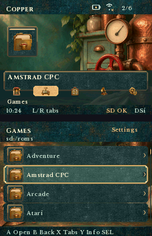
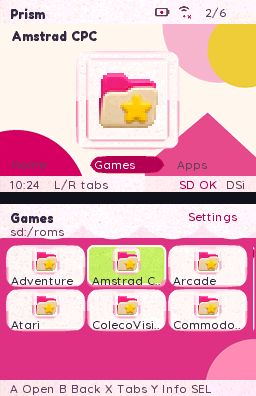
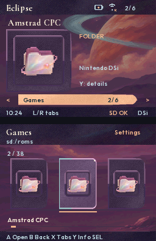
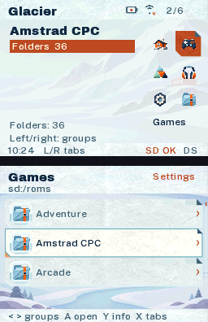
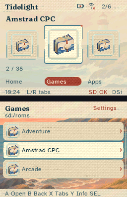
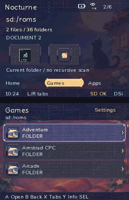
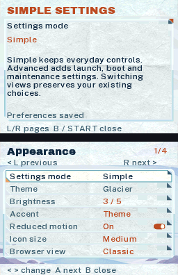
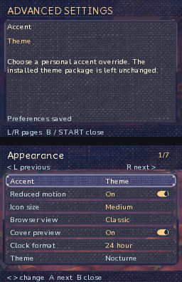
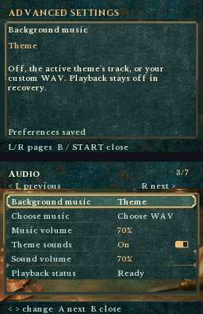

<div class="gloam-home" markdown="1">
<section class="gloam-hero" markdown="1">

<h1 class="gloam-visually-hidden">Gloam Shell NDX</h1>


<div class="gloam-hero-controls" markdown="1">

A launcher for games, apps and media on your **Nintendo DSi SD card**.

<div class="gloam-actions" markdown="1">

[Set up my SD card](#sd-setup-for-windows){ .md-button .md-button--primary }
[Community themes](https://nextcode4u.github.io/gloam-shell-theme-directory/){ .md-button }

</div>
<div class="gloam-badges" markdown="1">

[](https://github.com/nextcode4u/gloam-shell-ndx/releases/latest)
[](https://github.com/nextcode4u/gloam-shell-ndx/releases)

</div>
</div>
</section>

<details class="gloam-about" markdown="1">
<summary>What can Gloam do?</summary>

- **Games and homebrew.** Launch from your DSi SD card, with per-game settings and cheats for supported titles.
- **Emulators and media.** Open other systems’ games, books, music and videos through compatible apps installed with SD Setup.
- **Your collection.** Choose lists, grids, a shelf or an alphabetical index. Use folder tabs, favorites and library search to find things.
- **System apps.** Open DSi apps, installed DSiWare and Slot-1 through the routes available on your setup.
- **Your look and sound.** Customize themes, covers, icons, music, sounds and startup splashes.
- **Settings for everyone.** Choose Simple or Advanced settings. An optional Simple lock keeps a shared console easier to use.

[Read the controls and everyday guide →](USING.md)

</details>

<section class="gloam-setup" markdown="1">

## SD Setup for Windows

Install Gloam, add emulators and pick themes—all in one tool.

Back up your card first. Your DSi must already be able to run homebrew.
Not set up yet? Start with the [DSi homebrew guide](https://dsi.cfw.guide/), then come back here.

1. Open **Windows PowerShell**.
2. Copy this command, paste it into PowerShell and press **Enter**:

    ```powershell
    irm https://raw.githubusercontent.com/nextcode4u/gloam-shell-ndx/main/setup.ps1 | iex
    ```

3. Choose your SD card, click **Use folder**, then **Install / repair setup**.

[Need a hand?](INSTALL.md) · [Install without the tool](INSTALL.md#without-the-setup-tool)

</section>

<section class="gloam-showcase" markdown="1">

## Views and settings

<div class="gloam-showcase-tabs" role="tablist" aria-label="Explore Gloam" hidden>
<button type="button" role="tab" id="showcase-tab-browsing" aria-controls="showcase-browsing" aria-selected="true">Browsing</button>
<button type="button" role="tab" id="showcase-tab-top" aria-controls="showcase-top" aria-selected="false">Top screen</button>
<button type="button" role="tab" id="showcase-tab-settings" aria-controls="showcase-settings" aria-selected="false">Settings</button>
<button type="button" role="tab" id="showcase-tab-themes" aria-controls="showcase-themes" aria-selected="false">Themes</button>
</div>
<section class="gloam-showcase-panel" role="tabpanel" id="showcase-browsing" aria-labelledby="showcase-tab-browsing">
<p class="gloam-showcase-intro">Classic, grid, shelf or index. Choose how you browse.</p>
<div class="gloam-view-grid">
<figure>
<a href="images/showcase-classic.png" data-gloam-preview aria-label="Enlarge Classic preview"></a>
<figcaption><strong>Classic</strong><span>Folders and titles in a familiar list.</span></figcaption>
</figure>
<figure>
<a href="images/showcase-grid.png" data-gloam-preview aria-label="Enlarge Grid preview"></a>
<figcaption><strong>Grid</strong><span>More icons at a glance.</span></figcaption>
</figure>
<figure>
<a href="images/showcase-shelf.png" data-gloam-preview aria-label="Enlarge Shelf preview"></a>
<figcaption><strong>Shelf</strong><span>Larger cards for your collection.</span></figcaption>
</figure>
<figure>
<a href="images/showcase-index.png" data-gloam-preview aria-label="Enlarge Index preview"></a>
<figcaption><strong>Index</strong><span>Jump through alphabetical groups.</span></figcaption>
</figure>
</div>
</section>
<section class="gloam-showcase-panel" role="tabpanel" id="showcase-top" aria-labelledby="showcase-tab-top">
<p class="gloam-showcase-intro">Give both screens a job.</p>
<div class="gloam-view-grid">
<figure>
<a href="images/showcase-neighbors.png" data-gloam-preview aria-label="Enlarge Neighbors preview"></a>
<figcaption><strong>Neighbors</strong><span>See the nearby items while you browse.</span></figcaption>
</figure>
<figure>
<a href="images/showcase-smart.png" data-gloam-preview aria-label="Enlarge Smart preview"></a>
<figcaption><strong>Smart</strong><span>Folder summaries and item details as you browse.</span></figcaption>
</figure>
</div>
</section>
<section class="gloam-showcase-panel" role="tabpanel" id="showcase-settings" aria-labelledby="showcase-tab-settings">
<p class="gloam-showcase-intro">Start simple, or make it your own.</p>
<div class="gloam-view-grid">
<figure>
<a href="images/showcase-simple.png" data-gloam-preview aria-label="Enlarge Simple settings preview"></a>
<figcaption><strong>Simple settings</strong><span>Everyday choices in one place.</span></figcaption>
</figure>
<figure>
<a href="images/showcase-advanced.png" data-gloam-preview aria-label="Enlarge Advanced settings preview"></a>
<figcaption><strong>Advanced settings</strong><span>More control when you need it.</span></figcaption>
</figure>
<figure>
<a href="images/showcase-audio.png" data-gloam-preview aria-label="Enlarge Music and sounds preview"></a>
<figcaption><strong>Music and sounds</strong><span>Choose theme audio or your own music.</span></figcaption>
</figure>
</div>
</section>
<section class="gloam-showcase-panel" role="tabpanel" id="showcase-themes" aria-labelledby="showcase-tab-themes">
<p class="gloam-showcase-intro">Different artwork, layouts and sounds. Same Gloam.</p>
<a href="images/theme-variants.png" data-gloam-preview class="gloam-screens" aria-label="Enlarge theme previews"></a>
<p><a href="https://nextcode4u.github.io/gloam-shell-theme-directory/">Browse community themes →</a></p>
</section>
<p class="gloam-preview-note">Renderer previews with example content. Select a screen to enlarge it.</p>
</section>
<dialog id="gloam-preview" class="gloam-preview-dialog" aria-label="Gloam screenshot">
<form method="dialog"><button type="submit" autofocus>Close preview <span aria-hidden="true">×</span></button></form>

</dialog>

<nav class="gloam-home-links" aria-label="Getting help" markdown="1">

[How to use Gloam](USING.md) · [Need help?](HELP.md) · [GitHub](https://github.com/nextcode4u/gloam-shell-ndx)

</nav>
</div>
