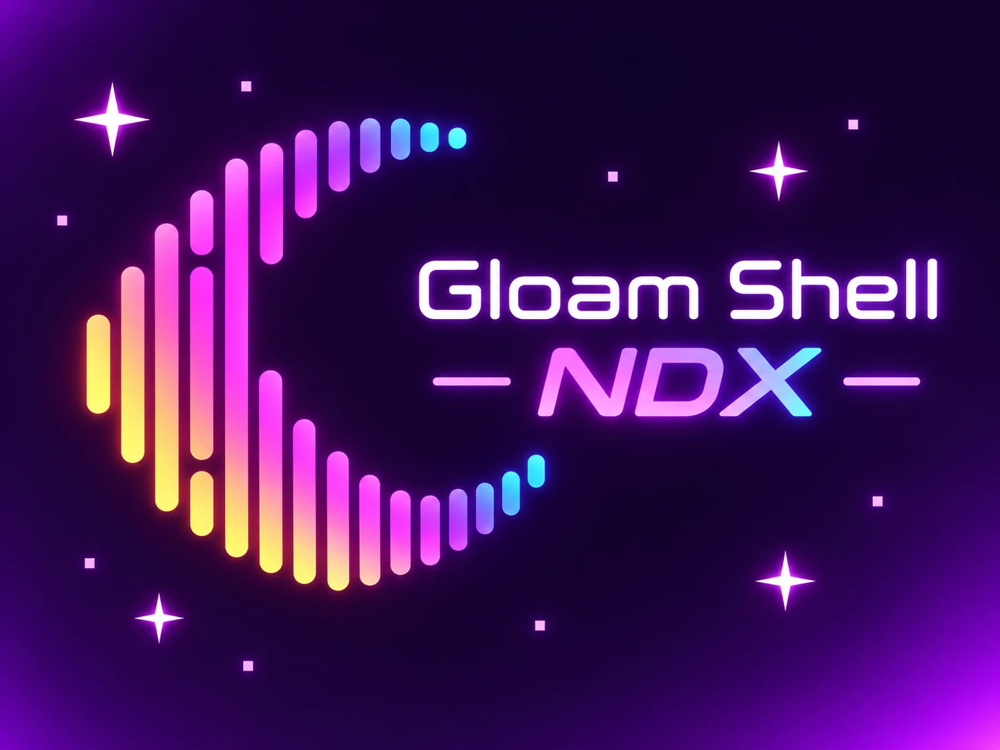
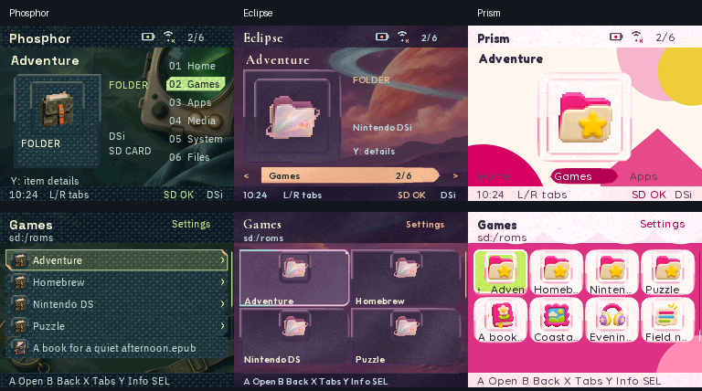

<section class="gloam-hero" markdown="1">

<h1 class="gloam-visually-hidden">Gloam Shell NDX</h1>

A launcher for games, apps and media on your **Nintendo DSi SD card**.

[Get Gloam](INSTALL.md){ .md-button .md-button--primary }
[Explore themes](THEMES.md){ .md-button }

</section>

<section class="gloam-showcase" markdown="1">

## Make it yours

{ .gloam-screens }

Theme previews with example content. Tap to view full size.

[Browse the collection →](https://github.com/nextcode4u/gloam-shell-theme-directory)

</section>
<nav class="gloam-home-links" aria-label="Getting help" markdown="1">

[How to use Gloam](USING.md) · [Need help?](HELP.md) · [GitHub](https://github.com/nextcode4u/gloam-shell-ndx)

</nav>

